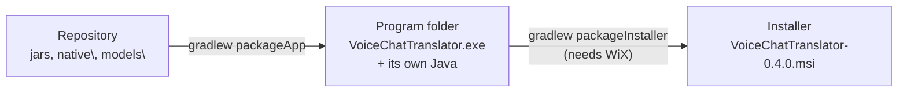

# Installing the app on Windows

`gradlew run` needs the repository folder and a terminal. This page builds a real Windows program:
a `VoiceChatTranslator.exe` with its own Java runtime, an icon, and (with the installer) a Start-menu
entry and a desktop shortcut.



## Before you start

Everything in [speech-setup.md](speech-setup.md) must be done, so that these exist in the repository:

| File | Copied into the program |
|---|---|
| `native\build\Release\vct_audio.dll` | yes |
| `native\stt\build\Release\vct_stt.dll` | yes |
| `native\sherpa-onnx\*.dll` | yes |
| `models\` (Whisper model and voice, about 1 GB) | yes, unless you add `-PnoModels` |

**Keep the CUDA Toolkit installed.** `vct_stt.dll` uses its CUDA DLLs, which are found through `PATH`
and are not copied (they are several hundred MB).

Run the commands in a normal PowerShell in the repository folder.

## Option A: the program folder (nothing else to install)

```powershell
.\gradlew packageApp
```

The result is the folder `build\jpackage\image\VoiceChatTranslator\`. It takes a minute or two (it
copies the 1 GB of models).

1. Copy the whole folder somewhere permanent, e.g. `C:\Users\<you>\Apps\VoiceChatTranslator\`.
2. Start `VoiceChatTranslator.exe` in it.
3. To start it from the Start menu: right-click the .exe → **Pin to Start**.

## Option B: the installer

The installer needs the free **WiX Toolset 3.14** to be built (only on your PC, not to install):

1. Download `wix314.exe` from https://github.com/wixtoolset/wix3/releases and run it. If Windows asks
   to turn on **.NET Framework 3.5**, allow it: WiX 3 needs it.
2. Open a **new** PowerShell, so it finds WiX.
3. Build the installer:

   ```powershell
   .\gradlew packageInstaller
   ```

   The result is `build\jpackage\installer\VoiceChatTranslator-0.4.0.msi`. Building the 1 GB
   installer takes several minutes.
4. Run it. It installs **for your user only**, under `%LOCALAPPDATA%`, so it needs no administrator
   rights. It adds **Voice Chat Translator** to the Start menu and a desktop shortcut.

To remove it: **Settings → Apps → Installed apps → VoiceChatTranslator → Uninstall**.

### Installing a newer version

Windows replaces the installed version only with a **higher** version number. Pass a new number
each time:

```powershell
git pull
.\gradlew packageInstaller -Pversion=0.4.1
```

Then run the new .msi.

## What changes compared with gradlew run

| | Installed app | `gradlew run` |
|---|---|---|
| Settings and API key | the same: `%APPDATA%\VoiceChatTranslator\settings.json` and Credential Manager | |
| DLLs and models | in the program folder (`app\native`, `app\models`) | in the repository |
| Transcripts | `%APPDATA%\VoiceChatTranslator\transcripts\` | `transcripts\` in the repository |
| Messages and errors | `%APPDATA%\VoiceChatTranslator\logs\app.log` (the previous run: `app.old.log`) | the terminal |

Relative paths in the settings, such as the default `models/whisper/...`, are looked up in the
program folder. A file you chose with **Browse...** keeps its full path.

## New in the installed app

- **One copy only**: starting it again shows the window of the copy that is already running (for
  example from the tray), instead of a second copy whose hotkeys would not work.
- **Settings → Program**:
  - **Start with Windows (in the tray)**: it starts when you sign in, with only the tray icon.
  - **Start listening as soon as the app opens**: the session starts without pressing Start.
    Together with the option above, the hotkeys and subtitles are ready right after sign-in.
    It loads Whisper onto the GPU (about 1 GB of video memory) and, with subtitles on, translates
    whatever the others say.

## If something does not work

Open `%APPDATA%\VoiceChatTranslator\logs\app.log`: it has the messages the terminal showed before.

| Problem | Cause |
|---|---|
| "Speech library ... could not load" | The CUDA Toolkit is missing, or a new terminal/sign-in is needed after installing it |
| "... not found: ...\app\models\..." | Built with `-PnoModels`: choose the model and voice with **Browse...** in Settings |
| `packageInstaller` says WiX was not found | Install WiX 3.14 (above), then open a new PowerShell |
| `packageApp` lists missing files | Build or download them first ([speech-setup.md](speech-setup.md)) |
