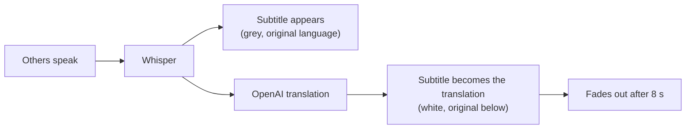

# Subtitles over the game

What the others say is translated into Chinese **automatically** and shown over the game, like film
subtitles. You don't need to press anything.

## Turning them on and off

- **Ctrl+Alt+S** (or the **Subtitles** button) shows or hides them, even while the game has focus.
- **While they are on**, every line of the others is translated: one OpenAI request per line. With
  gpt-4.1-mini that is still very cheap, but it is more requests than pressing Ctrl+Alt+T now and then.
- **While they are off**, nothing is sent to OpenAI. Ctrl+Alt+T keeps working as before.
- These lines are not translated, and are shown as they were said:
  - lines already in Chinese;
  - lines Whisper is unsure about (*unclear*);
  - very short sounds.

## The game must not be in exclusive full screen

A game in **exclusive full-screen** mode covers every other window, so the subtitles can't appear
over it. In the game's video settings, choose **Borderless**, **Windowed full screen** or
**Windowed**. Most games look the same in borderless mode.

## The subtitles never get in the way

- Mouse clicks go **through** them to the game.
- They never take the keyboard from the game.
- They are not shown in the taskbar or in Alt+Tab.

## Moving them

1. Press **Move subtitles** in the main window. A dashed frame with a sample line appears.
2. Drag it where you want it, e.g. above the game's own chat or below the map.
3. Press **Done moving**. The place is saved; with several monitors it stays on the one you chose.

To put them back in the default place (bottom centre of the main screen): **Settings → Subtitles over
the game → Put them back in the default place**.

## Settings

**Settings → Subtitles over the game**:

| Setting | What it does |
|---|---|
| Show what the others say as subtitles | Whether they are on when the app starts |
| Also read them aloud on my headphones | Speaks every translation, one after another (off by default) |
| Show the original under the translation | The English or Japanese in small text under the Chinese |
| Text size | 16 to 48 px |
| Each line stays | How long a line stays after its translation arrived (3 to 20 s) |

At most 3 lines are shown at once; a new line pushes out the oldest.
