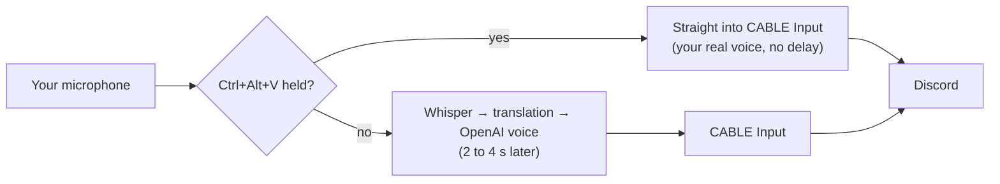

# Translate my speech: setup

You speak Chinese; the others in voice chat hear English or Japanese. Everything you say is translated
and spoken automatically. The others hear **only the translation**, never your real voice.

VB-CABLE is a free virtual audio cable: what the app plays into **CABLE Input** comes out of
**CABLE Output**, which Discord uses as its microphone.

## 1. Install VB-CABLE

1. Download the driver pack from https://vb-audio.com/Cable/ and unzip it.
2. Right-click **VBCABLE_Setup_x64.exe** → **Run as administrator** → **Install Driver**.
3. Restart Windows.

## 2. Check Windows' default devices (important)

The installation sometimes makes the cable the Windows default. Open **Settings → System → Sound** and check:

| Setting | Must be |
|---|---|
| Output (default playback) | Your **headphones**, e.g. "Headphones (WH-CH520)", **not** CABLE Input |
| Input (default microphone) | Your **real microphone**, e.g. "Headset (WH-CH520)", **not** CABLE Output |

If CABLE Input is the default output, you hear nothing. If CABLE Output is the default microphone,
the app would hear its own translations, so it refuses to start translate-my-speech and tells you why.

## 3. Discord

**User Settings → Voice & Video**:

- **Input Device**: **CABLE Output (VB-Audio Virtual Cable)**
- **Output Device**: your headphones (unchanged)
- **Input Profile**: **Studio** (in older Discord versions: Noise Suppression **None**). Voice Isolation
  and other noise filters can cut parts of a synthetic voice.
- Use **Let's Check** on the same page to hear what the others will hear. The meter only moves while
  the app is speaking a translation: start a session in the app and say something.

Newer VB-CABLE versions also add **CABLE In 16ch**. Don't use it: choose **CABLE Input** in the app.

## 4. The app

**Settings → Translate my speech**:

1. Tick **Translate everything I say and speak it into the voice chat**.
2. **Others hear**: English or Japanese, for this session.
3. **Send it to**: **CABLE Input**. If it says *"not found: is VB-CABLE installed?"*, go back to step 1.
4. **OpenAI voice**: e.g. `alloy`, `nova` or `onyx`.
5. OK, then **Start**.

The status line shows **My voice → English** (green). In the history, your lines show what was sent:
*sent to voice chat*, or why not: *unclear, not sent* or *too short, not sent*.

**Ctrl+Alt+M** (or **Pause my voice**) pauses it for side comments: nothing you say is sent until you
resume. The dot turns orange.

## 5. Talk live: your own voice, with no delay

When you speak English (or Japanese) yourself, **hold Ctrl+Alt+V** while you talk. Your real
microphone then goes straight into the voice chat, with no delay and nothing translated.

- The status line turns red: **LIVE: your own voice**.
- Keep all three keys held while you talk. If you let go of Ctrl and Alt but keep holding V, the game
  receives plain V key presses.
- It also keeps the last 0.15 s before you pressed the key and goes on for 0.3 s after you release it,
  so your first and last words are not cut off.
- What you say while live still appears in the history, marked *spoken live, not translated*. It is
  not sent a second time, and it costs nothing.
- Pressing the key cuts off the translation being spoken. Translations that become ready while you
  are talking wait until you release the key.
- It works even while translate-my-speech is paused (Ctrl+Alt+M).
- You can choose another key in **Settings → Hotkeys → Talk live (hold)**. Avoid keys that the game
  uses.

## Good to know

- **Delay**: the translation plays about 2 to 4 seconds after you stop speaking (pause detection,
  recognition, translation and the voice).
- **Cost**: every line you say is one translation request and one speech request to OpenAI.
- Coughs and very short sounds are not sent. Lines Whisper is unsure about are not sent either: say them again.
- If you already speak the target language (e.g. Japanese while "Others hear: Japanese") *without*
  holding the talk-live key, the line is still spoken by the OpenAI voice, as it is, without
  translating. Hold the talk-live key for your own voice with no delay.
- Translating others (Ctrl+Alt+T) keeps working at the same time, in Chinese, on your headphones only.
